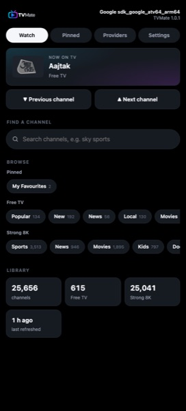

# TVMate

No-bullshit Android TV IPTV client. Live TV only: fast zapping, a clean guide, nothing else.


## Features

- **Xtream Codes**, any number of providers. VOD, 24/7 loops and PPV slots are dropped; quality variants (SD/HD/FHD/4K) merge into one channel with automatic fallback; channels are re-sorted by genre and country.
- **Free channels** (optional): the Xiaomi TV+ catalogue from every region, deduplicated, dead streams removed.
- **UP/DOWN zapping**, instant search, EPG, pinned sections.
- **Phone remote** (optional): scan a QR code to manage providers and pins or play channels from your phone. Off by default.
- **Self-updates** from GitHub releases.

| Guide | Search |
|---|---|
|  |  |

| Settings | Phone remote |
|---|---|
|  |   |

## Install

Download the APK from [Releases](../../releases/latest) and sideload it, e.g. `adb install TVMate-x.y.z.apk`.

**Remote:** UP/DOWN change channel · LEFT or OK opens the guide · RIGHT shows info · BACK twice exits.

## Build

```
./gradlew assembleDebug   # JDK 17
```

Pushing a `v*` tag builds a signed APK and publishes a release.
