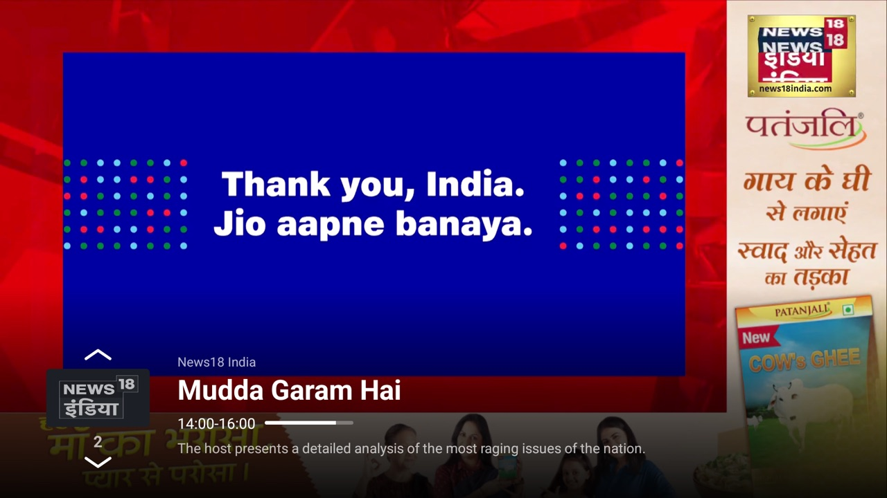
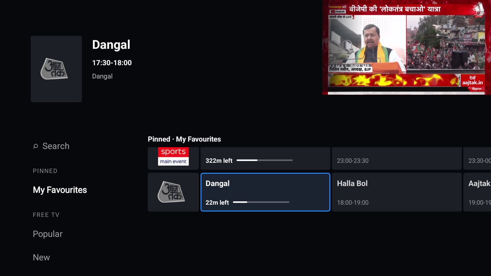
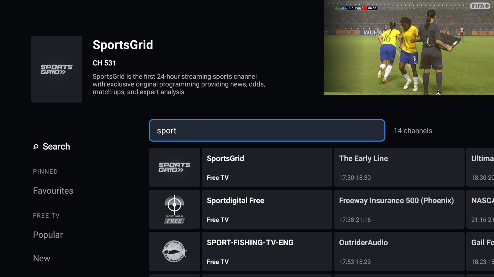
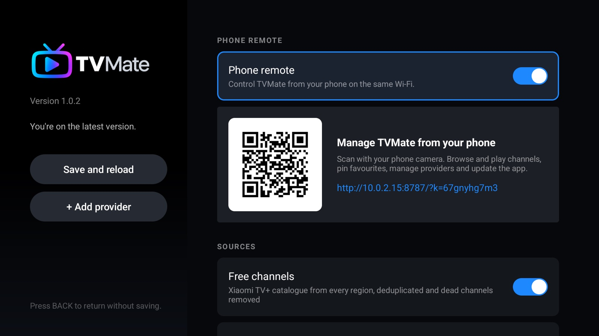
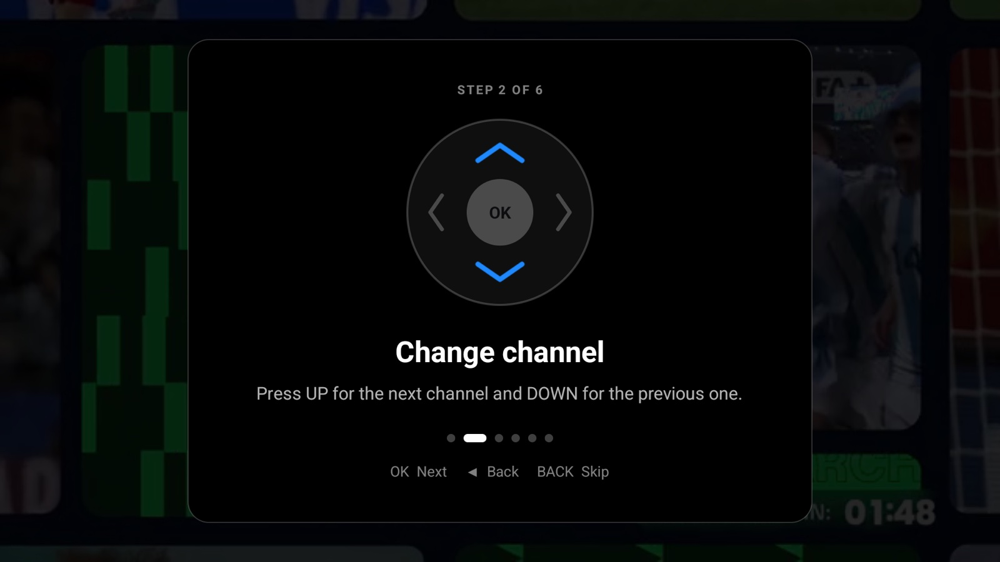
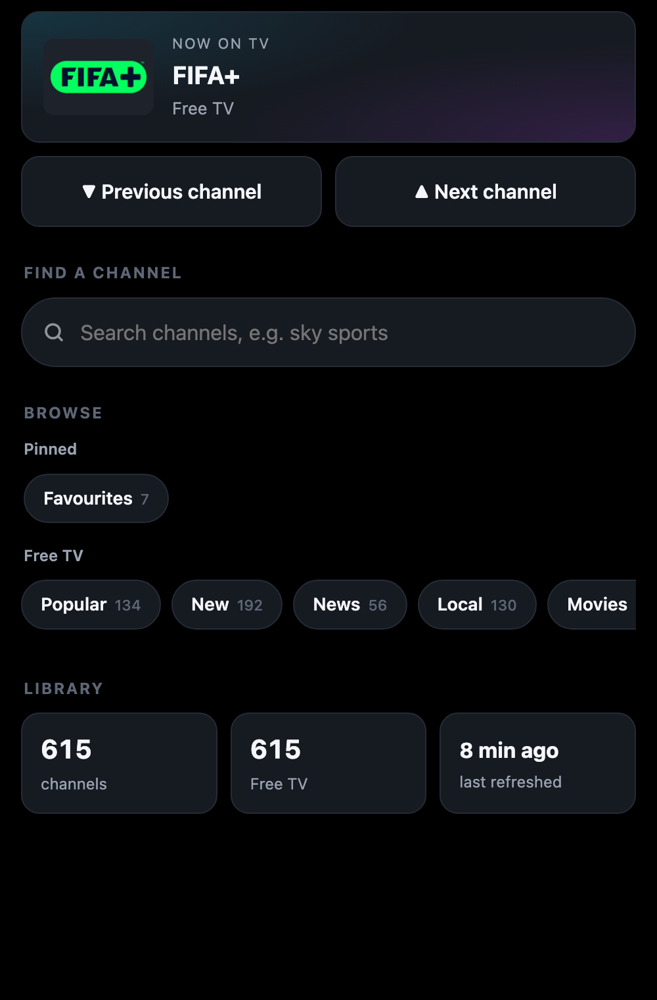
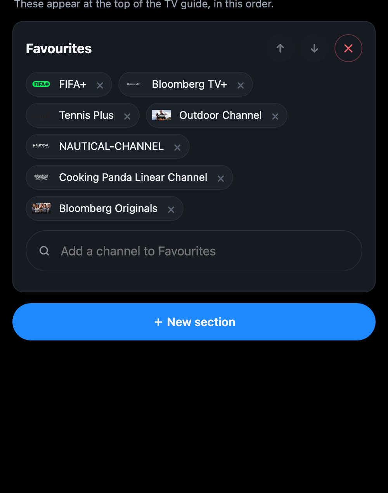

<p align="center"></p>

<p align="center"><b>No-bullshit Android TV IPTV client.</b><br>Live TV only. Fast zapping, a clean guide, nothing else.</p>

<p align="center"><a href="../../releases/latest"><b>Download the latest APK</b></a></p>



## Why TVMate

- **Clean Xtream lists.** Add any number of providers. VOD, 24/7 loops and PPV placeholders are dropped, SD/HD/FHD/4K variants merge into one channel with automatic fallback, and everything is regrouped by genre and country.
- **Free channels built in.** Optionally include the Xiaomi TV+ catalogue from every region, deduplicated, with dead streams removed.
- **Made for the remote.** UP/DOWN zaps, LEFT opens the guide, holding OK opens settings. A short tour on first launch shows the rest.
- **Phone remote.** Turn it on, scan the QR code, and browse, play, pin channels or manage providers from your phone. Off by default.
- **Updates itself** from GitHub releases.

| Guide | Search |
|---|---|
|  |  |
| **Settings** | **First-run tour** |
|  |  |

<p align="center">
  &nbsp;&nbsp;
  
</p>

## Install

Sideload the APK from [Releases](../../releases/latest), e.g. `adb install TVMate-x.y.z.apk`. Later versions install from inside the app.

| Key | Action |
|---|---|
| UP / DOWN | Next / previous channel |
| LEFT or OK | Guide |
| RIGHT | Programme info |
| Hold OK | Settings |
| BACK | Close, or twice to exit |

## Build

```
./gradlew assembleDebug   # JDK 17
```

Pushing a `v*` tag builds a signed APK and publishes a release.
